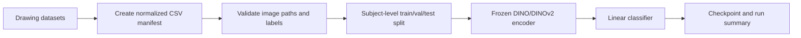
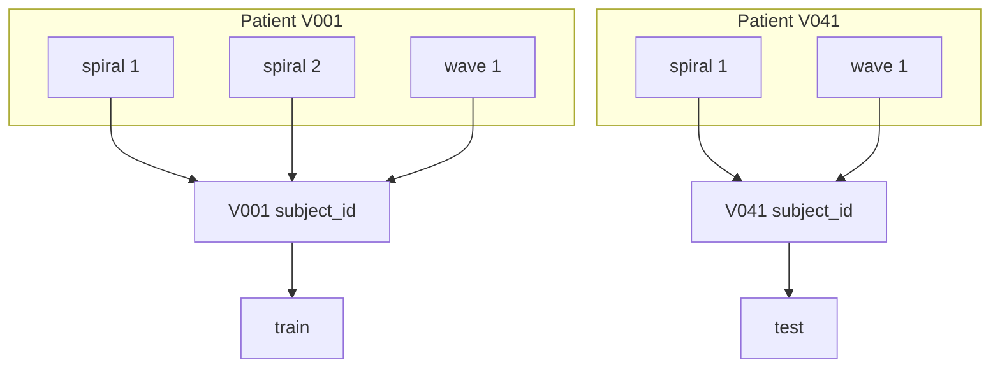

# Training Walkthrough

This is a notebook-style guide for preparing a manifest, running the training CLI, checking outputs, and plotting the first model results.

The goal is a leakage-aware baseline, not a final clinical claim. Treat the first run as a reproducibility check: the data split should make sense, the model should train without runtime surprises, and the output metrics should be easy to inspect.

## Pipeline



## 1. Install

Run from the repository root:

```sh
make install
```

If you only want to check the environment after installation:

```sh
uv run --all-groups pytest
```

That runs the root suite only (`testpaths = ["tests"]`). The `paper_reproduction` package lives in a
separate environment with its own tests; run both with `make test`, or that suite alone with
`make paper-reproduction-test`.

## 2. Create A Manifest

The package trains from a normalized CSV manifest. Each row is one image, with a participant-level identifier used for leakage-safe splitting.

```csv
image_path,subject_id,label,dataset,drawing_type
../hemato/V001/spiral_01/5_final/test3_spi_centered.png,V001,PD,hemato,spiral
../hemato/V041/spiral_01/5_final/test3_spi_centered.png,V041,HC,hemato,spiral
```

Required columns:

- `image_path`: absolute path, or relative to the manifest file.
- `subject_id`: participant ID. This must group every drawing from the same person.
- `label`: class label, usually `PD` or `HC`.

Create manifests from supported local layouts:

```sh
main-cli create-manifest hemato data/hemato data/manifests/hemato.csv
main-cli create-manifest niats-folador data/folador/HOG-IA-desenho-manuscrito/pyTremorDetect/dataset-junto data/manifests/niats_folador.csv
main-cli create-manifest image-tree data/my-labelled-images data/manifests/image_tree.csv
```

Use `hemato` for final `5_final/` crop trees — that key loads the **Moura** cohort, the NIATS-UFU
clinical dataset. Use `niats-folador` for the Folador NIATS folder layouts. Use `image-tree` only for
simple labelled folder trees where the parent folder can safely serve as the subject ID.

## 3. Validate The Manifest

```sh
main-cli validate-manifest data/manifests/hemato.csv
```

Preview split sizes before training:

```sh
main-cli split-summary data/manifests/hemato.csv --val-fraction 0.15 --test-fraction 0.15 --seed 42
```

Expected output shape:

```text
train=120 val=24 test=24
```

## 4. Train A Frozen DINO Classifier

The CLI trains a linear classifier on top of frozen timm image embeddings.

```sh
main-cli train \
  data/manifests/hemato.csv \
  runs/dinov2-hemato \
  --model-name vit_small_patch14_dinov2 \
  --image-size 518 \
  --epochs 20 \
  --batch-size 16 \
  --learning-rate 0.001 \
  --val-fraction 0.15 \
  --test-fraction 0.15 \
  --seed 42
```

Use `--device cpu` for a slow but predictable local smoke test. Use `--device cuda` when a GPU is available.

Why `--image-size 518`? In current timm builds, `vit_small_patch14_dinov2` expects `518x518` inputs. The repository config and CLI defaults are set to `518` out-of-the-box, ensuring a safe, assertion-free startup.

## 5. Inspect Outputs

Training writes:

- `runs/dinov2-hemato/best_classifier.pt`: checkpoint, label mapping, model name, image size, augmentation settings, and validation metrics.
- `runs/dinov2-hemato/run_summary.json`: split counts, subject counts, label mapping, and test metrics.
- `runs/dinov2-hemato/test_metrics.svg`: bounded test metrics as bars.
- `runs/dinov2-hemato/split_counts.svg`: image and subject counts per split.
- `runs/dinov2-hemato/validation_history.svg`: validation accuracy across epochs.

Quick shell check:

```sh
python -m json.tool runs/dinov2-hemato/run_summary.json
```

Expected summary shape:

```json
{
  "label_to_index": {
    "HC": 0,
    "PD": 1
  },
  "split_counts": {
    "train": 120,
    "val": 24,
    "test": 24
  },
  "subject_counts": {
    "train": 60,
    "val": 12,
    "test": 12
  },
  "test_metrics": {
    "loss": 0.69,
    "accuracy": 0.58,
    "balanced_accuracy": 0.57,
    "sensitivity": 0.50,
    "specificity": 0.64,
    "roc_auc": 0.61
  },
  "history": []
}
```

The binary path always writes the full suite above, which is what the "Things To Watch Out" section
below tells you to track — accuracy alone is not enough on imbalanced clinical data.

## Example Plots

These cells are written so they can be pasted into a notebook, a Python REPL, or a script.

The plotting cells require `matplotlib` in the environment where you run them. If it is not installed, run the cell in a notebook environment that already has it, or install it locally for analysis.

### Plot Split Counts

```python
import json
from pathlib import Path

import matplotlib.pyplot as plt

summary_path = Path("runs/dinov2-hemato/run_summary.json")
summary = json.loads(summary_path.read_text())

counts = summary["split_counts"]
fig, ax = plt.subplots(figsize=(6, 4))
ax.bar(counts.keys(), counts.values(), color=["#4c78a8", "#f58518", "#54a24b"])
ax.set_title("Images Per Split")
ax.set_ylabel("Image count")
ax.spines[["top", "right"]].set_visible(False)
plt.tight_layout()
plt.show()
```

### Plot Subject Counts

```python
subject_counts = summary["subject_counts"]
fig, ax = plt.subplots(figsize=(6, 4))
ax.bar(subject_counts.keys(), subject_counts.values(), color=["#4c78a8", "#f58518", "#54a24b"])
ax.set_title("Subjects Per Split")
ax.set_ylabel("Subject count")
ax.spines[["top", "right"]].set_visible(False)
plt.tight_layout()
plt.show()
```

### Plot Baseline Cross-Validation History

`train_baseline.py` writes richer epoch history to `runs/baseline_history.json`.

```sh
python train_baseline.py \
  --data-dir data/hemato \
  --model-type simple-cnn \
  --epochs 5 \
  --num-folds 5
```

```python
import json
from pathlib import Path

import matplotlib.pyplot as plt

history = json.loads(Path("runs/baseline_history.json").read_text())

fig, ax = plt.subplots(figsize=(7, 4))
for fold in history["folds"]:
    epochs = [row["epoch"] for row in fold["epochs"]]
    balanced_accuracy = [row["balanced_accuracy"] for row in fold["epochs"]]
    ax.plot(epochs, balanced_accuracy, marker="o", label=f"fold {fold['fold']}")

ax.set_title("Validation Balanced Accuracy By Fold")
ax.set_xlabel("Epoch")
ax.set_ylabel("Balanced accuracy")
ax.set_ylim(0, 1)
ax.legend()
ax.spines[["top", "right"]].set_visible(False)
plt.tight_layout()
plt.show()
```

## Data Split Diagram

The split must happen at participant level. If one patient contributes multiple drawings, every drawing from that patient must stay in one split.



## Things To Watch Out

- Patient leakage: `subject_id` must be the real participant ID, not a drawing ID, crop folder, or filename stem unless that stem truly identifies the person.
- Moura layout: the `hemato` loader uses the top folder under the dataset root as `subject_id` and stores the final-crop parent folder as `drawing_session`. Check the generated manifest if your local layout differs.
- DINO input size: pass `--image-size 518` with `vit_small_patch14_dinov2` unless the code is updated to configure timm for another size.
- Split balance: subject splits are label-stratified in the main CLI, ensuring robust and balanced patient counts across train, validation, and test sets.
- Small validation sets: a single missed subject can swing metrics sharply. Prefer reporting confidence intervals or cross-validation for paper-facing claims.
- Augmentation: keep drawing augmentations conservative. Large rotations, flips, or heavy crop jitter can change the clinical signal or create unrealistic samples.
- External datasets: keep project-specific datasets in manually reviewed manifests instead of growing loader code for every source.
- Metrics: accuracy is not enough for imbalanced medical data. Track balanced accuracy, sensitivity, specificity, ROC-AUC, and per-class counts.
- Reproducibility: save the manifest, seed, CLI command, git commit, and `run_summary.json` with every result.

## Minimum Result Checklist

Before sharing a model result, confirm:

- The manifest path exists and every image file resolves.
- `subject_id` groups by participant.
- Each split has both labels, or the limitation is clearly stated.
- `run_summary.json` has the expected split and subject counts.
- The model input size matches the timm model.
- The reported metric names match the split used for model selection.
- Any external dataset limitations are included in the result notes.
